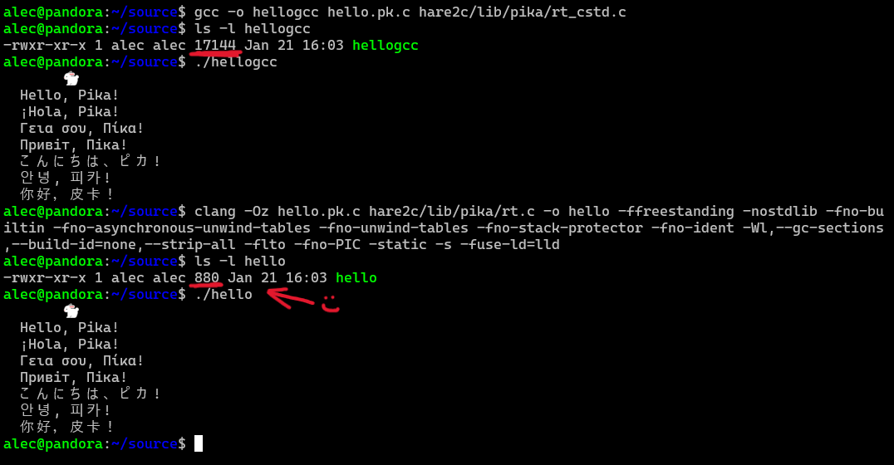

# Hare2C: A Hare-to-C11 Transpiler
[](https://builds.sr.ht/~alecgraves/hare2c/commits/master/ubuntu.yml?)

A family of Hare-to-GNU-C11 transpilers with three working implementations:
- **hare2c.py** - Python reference/bootstrap implementation (~3,000 lines)
- **hare2c** - Self-hosted Hare metatranspiler (11 .ha files, ~15,000 lines)
- **pika2c** - Self-hosted Pika metatranspiler (10 .pka files, ~8,000 lines)

hare2c and pika2c share the same standard runtime, though memory allocation features are not exposed by pika2c. Hare2c is about 200KB compiled with `clang -O3`, while pika2c is about 100KB.

- Hare2C online WASM demo: https://alecgraves.net/hare2c.html
- Pika2C online WASM demo: https://alecgraves.net/pika2c.html

## Project Goals

- **Vendor-supported compilation** - Use mature hardware-vendor-supported C compilers (GCC, Clang) with advanced features (asan, ubsan, static analyis, shadow stack, etc.) for performant and reliable production code
- **Minimal footprint** - Freestanding runtime compiles to < 8KB
- **Self-hosting** - Metatranspilers written in the languages they transpile
- **Embedded-friendly** - Freestanding environment, no libc dependency, suitable for kernels and microcontrollers

## Directory Structure

```text
hare2c/
├── Makefile                   # Unified build system
├── README.md                  # This file
├── COPYING
├── docs/                      # Documentation, reference, and playground assets
│   ├── Makefile
│   ├── hello.png
│   ├── pika.md
│   ├── pika_introduction.md
│   ├── pikav1.md
│   ├── test/
│   └── tmp/
├── cmd/                       # Command-line transpilers
│   ├── hare2c/                # Self-hosted Hare (11 .ha files)
│   ├── pika2c/                # Self-hosted Pika (10 .pka files)
│   └── hare2c.py              # Python reference transpiler (~3k LOC)
├── lib/                       # Runtime libraries and helpers
│   ├── hare/                  # C runtime shared by Hare and pika2c
│   │   ├── rt.c
│   │   ├── rt_cstd.c
│   │   └── rt_wasm.c
│   ├── pika/                  # Minimal runtime surface for Pika
│   │   ├── rt.c
│   │   ├── rt_cstd.c
│   │   └── rt_wasm.c
│   └── harec/                 # Hare compiler runtime modules
│       ├── rt/
│       │   ├── syscalls.ha
│       │   ├── memcpy.ha
│       │   ├── memmove.ha
│       │   ├── memset.ha
│       │   ├── strcmp.ha
│       │   ├── abort.ha
│       │   ├── alloc.ha
│       │   └── start.ha
│       └── strings/
│           └── syscalls.ha
├── WASM/                      # Build/test helpers
│   ├── build_wasm_hare.sh     # Produce WASM version of hare2c
│   ├── build_wasm_pika.sh     # Produce WASM version of pika2c
│   └── test_wasm.sh           # Smoke the WASM output locally
├── build/                     # Build artifacts (`make`, `make wasm`, `make optimize-*`)
│   ├── hare2c
│   ├── hare2c.bolt
│   ├── pika2c
│   ├── pika2c.bolt
│   └── wasm/                  # WASM demo website
│       ├── hare2c.wasm
│       ├── hare.html
│       ├── pika2c.wasm
│       ├── pika.html
│       ├── pika2js.html
│       └── pika2glsl.html
└── test/                      # Test suites and runners
    ├── hare/
    │   └── fail/              # Negative Hare examples
    ├── pika/
    │   └── fail/              # Pika compile/runtime failure tests
    ├── test_hare_tests.sh
    ├── test_hare2c.sh
    ├── test_hare2c_py.sh
    └── test_pika2c.sh
```

## Quick Start

### Using the Makefile

```bash
# Build both transpilers
make

# Run all test suites (418 validations total)
make check

# Build individual transpilers
make hare2c      # Self-hosted Hare transpiler
make pika2c      # Self-hosted Pika transpiler

# Build WebAssembly versions
make wasm

# Clean build artifacts
make clean
```

## SYCL Backend Notes

- SYCL kernel error reporting packs line/column into 16-bit fields. Kernel sources
  with a line or column >= 65536 will have the location truncated.

### Using Python Transpiler Directly

```bash
# Single file
python3 hare2c.py input.ha -o output.c

# Multiple files with package name
python3 hare2c.py -N mypackage file1.ha file2.ha -o output.c

# Compile and link
gcc -std=c11 output.c lib/hare/rt.c -o program
```

### Example: Minimal Binary

```bash
# Test with runtime
gcc test/hare/rt_test.c lib/hare/rt.c -o hellogcc
ls -l hellogcc
# -rwxr-xr-x 1 alec alec 17144 Jan 21 16:03 hellogcc

# Optimized minimal binary
clang -Oz hello.pka.c hare2c/lib/pika/rt.c -o hello -ffreestanding -nostdlib -fno-builtin -fno-asynchronous-unwind-tables -fno-unwind-tables -fno-stack-protector -fno-ident -Wl,--gc-sections,--build-id=none,--strip-all -flto -fno-PIC -static -s -fuse-ld=lld
ls -l hello
# -rwxr-xr-x 1 alec alec 880 Jan 21 16:11 hello
```



## Using with Official Hare Compiler

The project includes an `rt/` module that allows compiling Hare code with the official Hare compiler (`hare build`) while using our custom C runtime.

### Quick Start

```bash
# Build the C runtime
cc -c -std=c11 -ffreestanding -nostdlib -fno-builtin -O2 lib/hare/rt.c -o lib/hare/rt.o
ar rcs librt.a lib/hare/rt.o

# Compile Hare program with our runtime
hare build -RFo output -L. -lrt yourfile.ha

# Run
./output
```

### Example Program

```hare
// test.ha
use rt;
use strings;

export fn main() void = {
        let msg = "       🐇
  Hello, Pika!
  ¡Hola, Pika!
  Γεια σου, Πίκα!
  Привіт, Піка!
  こんにちは、ピカ!
  안녕, 피카!
  你好, 皮卡!
";
        rt::write(1, strings::toutf8(msg): *[*]u8, len(msg));
}
```

```bash
hare build -RFo test -L. -lrt test.ha && ./test
```

### What's Provided

The `rt/` module provides:
- **System calls**: `write`, `read`, `exit`
- **Memory ops**: `memcpy`, `memmove`, `memset`
- **String comparison**: `strcmp`
- **Abort/assertions**: `abort`, `abort_fixed`
- **Entry point**: `_main` that calls user's `main()`

All functions are `@symbol` bindings to our C runtime in `lib/hare/rt.c`, so you get the same optimized, freestanding runtime as the transpiler, but can use the official Hare compiler for development.

## The Pika Language

**Pika** is a safer subset of Hare designed for security-critical applications. It eliminates entire classes of bugs at compile time through stricter rules. I made it for robots / microcontrollers / embedded systems (and I removed features to make the transpiler implementation simpler).

### Key Safety Features

* **Same Hare-standard nullable pointer compile-time checks, runtime array bounds checks, string safety**
```hare
// ERROR: cannot dereference nullable pointer (use match to narrow type)
fn bad(p: nullable *i32) i32 = {
return *p;
};

// ERROR: cannot cast str to *[*]u8
export fn _main() void = {
   let s = "hello": *[*]u8;
};

// RUNTIME ERROR: index out of bounds (And compile-time warning with clang)
use rt;
export fn _main() void = {
   let arr: [3]i32 = [1, 2, 3];
   let x = arr[5];  // out of bounds
};
```

* **Exhaustive Pattern Matching**
```hare
// ERROR: match not exhaustive: missing cases
type result = (i32 | bool);
type my_result = result;

fn test_match() void = {
   let r: my_result = 0: my_result;
   match (r) {
   case i32 => void;
   // missing bool variant
   };
};

// ERROR: switch not exhaustive: missing cases
type color = enum { RED, GREEN, BLUE };

fn test_switch() void = {
   let c: color = color::RED;
   switch (c) {
   case color::RED => void;
   case color::GREEN => void;
   // missing color::BLUE
   };
};
```

* **No dynamic memory**
   - Kinown and constrained memory footprint
   - Use static instead

* **No recursion allowed**
   - Simpler control flow, provably bounded call stack size
```
// ERROR: direct recursion is prevented at transpile-time
fn factorial(n: i32) i32 = {
   if (n <= 1) {
      return 1;
   };
   return n * factorial(n - 1);
};
```
* **No error propagation**
   - Simpler control flow

* **No function pointers**
   - More compiler performance optimization, support for more architectures

* **Stricter Compile-Time Checks**
   - Shadowed globals detected
   - Match / Case usage restrictions
   - no if expressions
   - Clearer error messages
```hare
// ERROR: variable shadowing is not allowed in pika
let x: i32 = 1;

fn test() void = {
   let x: i32 = 2;  // shadows global
};
```

> *And so much more... limitations make for great art.*

### Why Use Pika?

- **Security** - Eliminates null pointer bugs, array overruns (same as Hare!)
- **Embedded** - Simpler semantics, smaller code, more predictable execution
- **Teaching** - Clearer mental model for beginners
- **Verification** - Easier to formally verify
- **Performance** - No hidden costs

## Test Results

### Harec Compiler (test_hare_tests.sh)
- check that the hare and pika transpilers can be compiled with `hare build -RF ...`
- test that all of the test files build wtih `hare build -RF ...`
- **Total: 71/71**

### Python Transpiler (test_hare2cpy.sh)
- Hare tests
- Pika success tests
- Pika failure tests (compile + runtime)
- **Total: 112/112**

### Hare Metacompiler (test_hare2c.sh)
- inline tests
- All Hare tests
- All Hare failure tests
- All Pika tests
- All Pika failure tests
- **3-generation self-hosting** (bootstrap -> gen1 -> gen2 -> gen3)
- **Fixed-point verification** (gen2 == gen3)
- **Total: 150/150**

### Pika Transpiler (test_pika2c.sh)
- All Pika test files
- All Pika failure tests
- **3-generation self-hosting**
- **Fixed-point verification**
- **Total: 82/82**

All scripts currently pass with zero unexpected failures.

## Runtime Libraries

### rt.c - Freestanding Runtime

No libc dependency. Suitable for kernels and embedded systems.

**Features:**
- Bump allocator with static heap (configurable size)
- Optimized memory operations (64-byte unrolling)
- Direct syscalls on x86_64/aarch64/riscv64
- @init/@fini/@test function support
- Custom abort handlers

**Key Functions:**
```c
void  rt_memcpy(void* dest, const void* src, size_t n);
void  rt_memmove(void* dest, const void* src, size_t n);
void  rt_memset(void* dest, uint8_t val, size_t n);
int   rt_strcmp(hare_str a, hare_str b);
void* rt_malloc(size_t n);
void  rt_free(void* p);
void  rt_exit(int status);
int64_t rt_write(int fd, const void* buf, size_t count);
int64_t rt_read(int fd, void* buf, size_t count);
```

### rt_cstd.c - Standard Library Runtime

Uses libc for easier integration with existing systems.

### rt_wasm.c - WebAssembly Runtime

Specialized runtime for wasm32 environments with host-provided memory (no Emscripten required).

## WebAssembly Support

Both Hare2C and Pika2C transpilers can be compiled to WebAssembly (html web demo):

```bash
# Build WASM versions
make wasm

# Manually build Hare WASM
bash wasm/build_wasm_hare.sh

# Manually build Pika WASM
bash wasm/build_wasm_pika.sh

# Test WASM compilation
bash wasm/test_wasm.sh
```

Output: `build/wasm/hare2c.wasm` and `build/wasm/pika2c.wasm` plus HTML demos in the same directory.

## Hare Language Features Supported

### Core Features
- **Types**: Primitives, arrays, slices, structs, enums, tagged unions, pointers, functions
- **Control flow**: if/else, for, switch, match, break, continue, yield
- **Functions**: Regular, variadic, defaults, @init/@fini/@test/@symbol attributes
- **Memory**: Stack, static, heap (alloc/free), append, insert, delete
- **Error handling**: Error types (`!T`), propagation (`?`), assertion (`!`)
- **Modules**: use statements, package support (-N flag)

### Limitations
- No standard library (freestanding environment with rt and limited strings only)
- Memory allocator not thread-safe
- No full coverage of Hare language, definite weaknesses in user-defined type support, nested struct features, no automatic struct initialization, etc.

## Implementation Details

### Transpiler Phases

1. **Tokenization** - Regex-based lexer
2. **Parsing** - Recursive descent parser
3. **Type Collection** - Forward references resolution
4. **Code Generation** - Pattern-matching dispatch

### Generated Code

- Tagged unions use `struct { uint32_t tag; union { ... } val; }`
- Bounds checking via `HARE_BOUNDS_CHECK` macro
- Slices generate `struct { T* data; size_t length; size_t capacity; }`
- Strings generate `struct { uint8_t* data; size_t len; }` (no null terminator)

### Optimization Tips

1. **Compiler flags**:
```bash
clang hello.pka.c hare2c/lib/pika/rt.c -o hellofast  -O3 -flto -march=native -mtune=native -ffast-math -Wconversion -Wfloat-conversion -Wno-gnu-auto-type -Wno-unused-function -Wno-gnu-statement-expression -Wno-parentheses-equality -ffunction-sections -fdata-sections -Wl,--gc-sections
```

3. **Size optimization**:
```bash
clang -Oz hello.pka.c hare2c/lib/pika/rt.c -o hellosmall -ffreestanding -nostdlib -fno-builtin -fno-asynchronous-unwind-tables -fno-unwind-tables -fno-stack-protector -fno-ident -Wl,--gc-sections,--build-id=none,--strip-all -flto -fno-PIC -static -s -fuse-ld=lld
```

## Example Programs

All examples are in `test/hare/`. Highlights:

| File | Description |
|------|-------------|
| **basic.ha** | Functions, structs, arrays, pointers |
| **errors.ha** | Error types, match, propagation |
| **tagged_union.ha** | Union types, is operator, match |
| **memory.ha** | Heap alloc, slices, append/delete |
| **strings.ha** | String module, conversions |
| **numeric_mandelbrot.ha** | Complex math, f64 |
| **numeric_pi_monte_carlo.ha** | PRNG, Monte Carlo estimation |
| **variadic.ha** | Variadic functions, defaults |
| **init_fini.ha** | Lifecycle attributes |
| **pkg_main.ha** + **pkg_util.ha** | Multi-file packages |

## Development

### Running Tests

```bash
# Test Python transpiler
cd test && bash test_hare2cpy.sh

# Test Hare metacompiler
cd test && bash test_hare2c.sh

# Test Pika transpiler
cd test && bash test_pika2c.sh

# Or use Makefile
make check
```

### Building from Source

```bash
# Clone repository
git clone <repo-url>
cd hare2c

# Build both transpilers
make

# Verify installation
./build/hare2c --help
./build/pika2c --help
```

### Adding New Tests

1. Add `.ha` file to `test/hare/` or `.pka` file to `test/pika/`
2. Run test suite: `make check`
3. Failure tests go in `test/hare/fail` `test/pika/fail/`

## Architecture

### Bootstrap: hare2c.py (Python)
- **Lines**: ~3,000
- **Phases**: Tokenize -> Parse -> Generate
- **AST**: Pattern-matched tuples
- **Speed**: ~500ms for hare2c

### cmd/hare2c (Hare)
- **Files**: 11 modules
- **Lines**: ~15,000
- **Features**: Arena allocation, zero-copy parsing, struct AST's
- **Speed**: ~10ms for self-hosting

### cmd/pika2c (Pika - subset language)
- **Files**: 9 modules
- **Lines**: ~8,000 (4,000 pika-specific)
- **Features**: Stricter safety, exhaustive matching, reduced feature set
- **Speed**: ~9ms for self-hosting

## License

🔥⚖ AGPLv3 ⚖🔥

See COPYING file for details.

## Contributing

This is a personal research project. For questions or suggestions, please email or catch me on IRC.

## Resources

- **Hare Language**: https://harelang.org/
- **Pika Documentation**: See `docs/` directory
- **Pika Spec**: `docs/pika.md`
